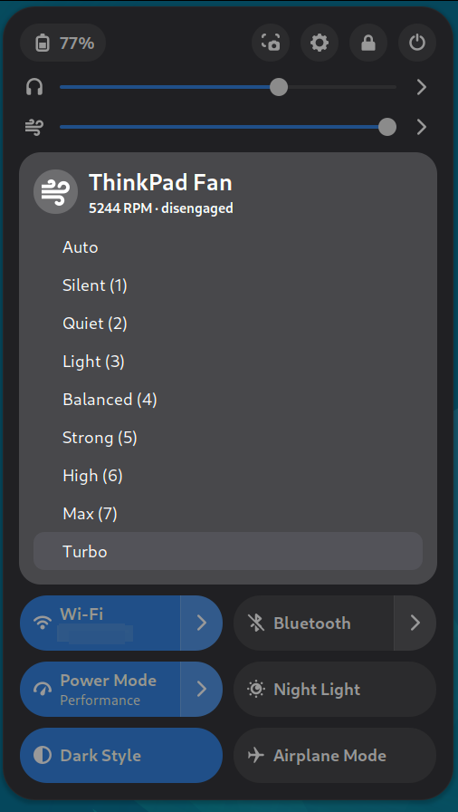

# ThinkFan Control

GNOME Shell extension that adds a fan control to the **Quick Settings** panel on ThinkPads, using the `thinkpad_acpi` driver.

<p align="center">
  
</p>

- Slider right below the volume control, with one zone per level: Auto, 1 to 7, and Turbo (`full-speed`).
- Menu (the slider's arrow button) listing all levels, with the current one marked and the RPM and level shown in the header.
- Clicking the icon switches back to **Auto**.
- Status refreshed every 3 s from `/proc/acpi/ibm/fan`.
- Level 0 (off) is not offered, for safety. The `disengaged` level is commented out in the code.

## Requirements

- A ThinkPad with `thinkpad_acpi`
- GNOME Shell 48 (`"shell-version": ["48"]`)
- `pkexec` (polkit)

## Installation

From a `.deb` package built from source:

```sh
make install     # builds and runs: sudo apt install ./build/thinkfan-gnome-extension_<version>_all.deb
```

Or just build the package without installing it:

```sh
make deb         # output in build/
make clean
```

After installing:

1. **Reboot** (or reload the `thinkpad_acpi` module). The package writes `/etc/modprobe.d/thinkfan.conf` with `options thinkpad_acpi fan_control=1 experimental=1`, which only takes effect the next time the module is loaded.
2. Enable the extension:
   ```sh
   gnome-extensions enable thinkfan@growlnx
   ```

## How it works

```
Slider/menu (extension.js)
   └─ pkexec /usr/bin/thinkfan-set <level>
         └─ echo "level <level>" > /proc/acpi/ibm/fan
```

| Path in the package | Purpose |
|---|---|
| `/usr/share/gnome-shell/extensions/thinkfan@growlnx/` | The extension (`extension.js`, `metadata.json`) |
| `/usr/bin/thinkfan-set` | Shell helper that validates the argument (`auto`, `full-speed`, `disengaged` or `0`-`7`) and writes to `/proc/acpi/ibm/fan` |
| `/usr/share/polkit-1/actions/org.growlnx.thinkfan.policy` | Polkit action `org.growlnx.thinkfan.set`, bound to `/usr/bin/thinkfan-set` |
| `/etc/modprobe.d/thinkfan.conf` | Enables `fan_control=1` and `experimental=1` |

Writing to `/proc/acpi/ibm/fan` requires root, so the extension calls the helper through `pkexec`. Under the polkit policy, users in an **active local session** can run it without a password; inactive or remote sessions are denied.

## Warning

Controlling the fan manually can cause overheating. `fan_control=1` disables part of the firmware's protections at manual levels. Use at your own risk, and avoid low levels under heavy load.

## License

[MIT](LICENSE)

## Author

[growlnx](https://github.com/growlnx) · <https://github.com/growlnx/thinkfan-gnome-extension>
